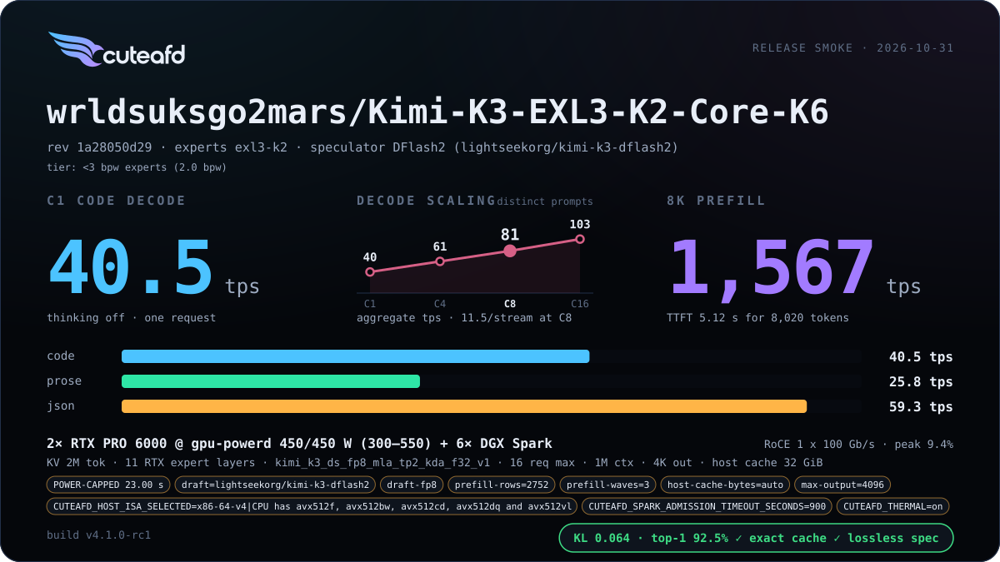

# Kimi K3

`wrldsuksgo2mars/Kimi-K3-EXL3-K2-Core-K6` serves on two RTX PRO 6000 GPUs plus
six Sparks: EXL3 K2 routed experts on the Sparks (with RTX onboarding), and a
native K6 dense core (attention, dense and shared FFN, vocabulary head) on the
RTX cards. Drafts come from DFlash2. Kimi K3 has no MTP.

On an active two-RTX split with DFlash2, `TP2_DFLASH=on` is the default:
the draft cache and attention are split by Context across both GPUs, while
producer weights and FFN stay on GPU1. This balances memory and compute;
the [qualification card](https://github.com/tpurtell/cuteafd/pull/1371)
reduced the per-GPU memory gap from 3.83 to 2.38 GiB with effectively tied
decode throughput. Larger KV pools can use the freed GPU1 headroom.
Set `TP2_DFLASH=off` to keep the draft on GPU1; direct CLI users can pass
`--tp2-dflash false`. Single-GPU or non-DFlash2 configurations default off.

Starting config (replace the REPLACE-ME Spark hosts and the 192.0.2.x RoCE
addresses): [max](../../examples/configs/kimi-k3-exl3-k6-max.config).

## Attention Views

`wrldsuksgo2mars/Kimi-K3-EXL3-K2-Core-K6-HQA` bundles three attention modes.
Set `MODEL_ID` to this checkpoint and `MODEL_REVISION` to
`46b802d31c737bc64b4251ad158b9b3ffc4e04f6` when adapting the starting config.
The default HQA view retains native BF16 attention output and MLA query
projections alongside the K6 core. `COMPACT_ATTENTION=on` selects the bundled
parent K6 attention; `FP8_COMPACT_ATTENTION=on` instead converts the selected
native BF16 projections to block-scaled FP8, with BF16 activations. These
options are mutually exclusive.

The corresponding CLI flags are `--compact-attention` and
`--fp8-compact-attention`. Plan, inspect, serve and golden select the complete
checkpoint bundle before planning or loading. Incomplete or mixed bundles
refuse, and each mode has its own checkpoint fingerprint and memory charges.

## Release card

