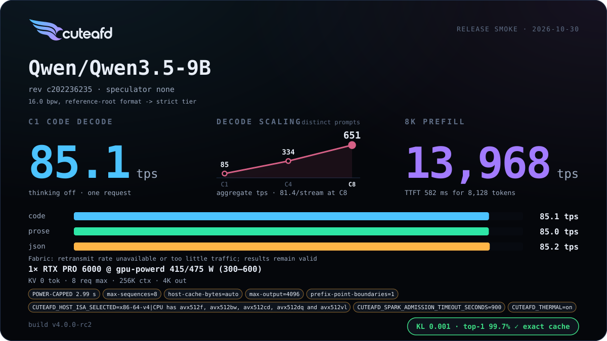
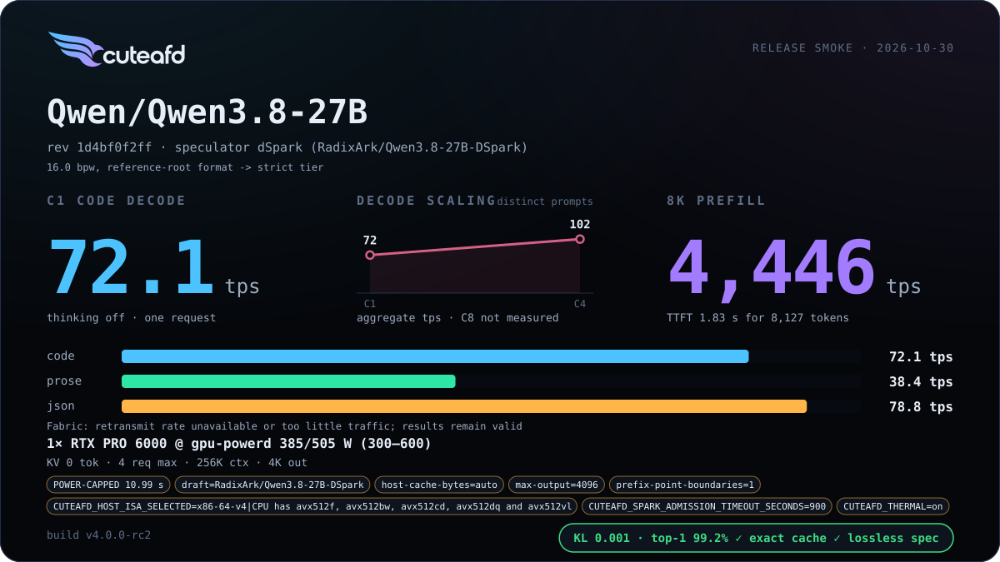
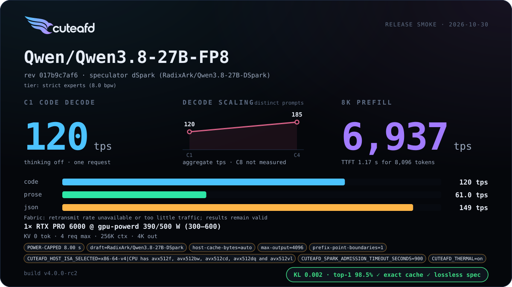

# Dense Qwen 3.5 / 3.8

Dense Qwen checkpoints serve on one RTX PRO 6000 from their own Hugging Face
headers: `Qwen/Qwen3.5-9B` (BF16), and `Qwen/Qwen3.8-27B` in BF16 and FP8.
With no routed experts there is nothing to place on Sparks, so these layouts use
no Sparks. Qwen 3.8 27B drafts with dSpark; Qwen 3.5 9B runs without a drafter.
A dense card admits 4 concurrent requests (8 for the 9B), so its widest
concurrency point is that limit.

Starting configs: [Qwen 3.5 9B BF16](../../examples/configs/qwen35-9b-bf16-min.config) ·
[Qwen 3.8 27B BF16](../../examples/configs/qwen38-27b-bf16-min.config) ·
[Qwen 3.8 27B FP8](../../examples/configs/qwen38-27b-fp8-min.config).

## Release cards

