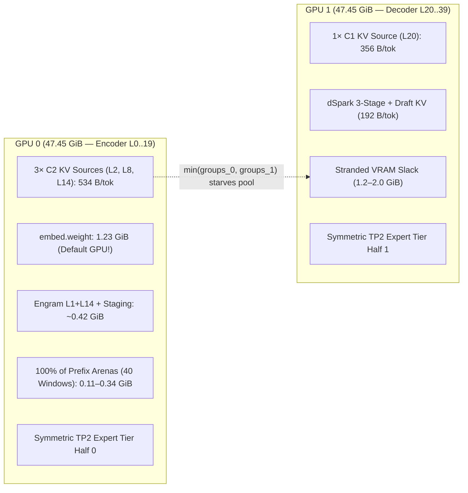

# DeepSeek-V4.1-Flash on Dual RTX 4090 D 48GB (`sm_89`): Engine, Kernel & KV Cache Review

**Reviewed Commits:**
- `cuteafd`: [`379b26792`](https://github.com/hughmadden/cuteafd/commit/379b267921fa983035107c6c01d800fd27294075) (116 non-merge commits ahead of upstream `c64956704`)
- `sparkinfer-glmrt`: [`ce9aec54`](https://github.com/hughmadden/sparkinfer-glmrt/commit/ce9aec549307cf7736ea296b0e71d190923fc9c1) (9 commits ahead of upstream `78cfee4e`)

**Target Hardware Topology:**
- **Coordinator GPUs:** 2× NVIDIA GeForce RTX 4090 D 48GB (`sm_89`, Ada Lovelace — 114 SMs, `47.45 GiB` / `50,950,569,984 B` usable GDDR6X per GPU, `1,008 GB/s` peak DRAM bandwidth, `72 MB` L2 cache, `101,376 B` / `99 KB` max dynamic shared memory per CTA, `65,536` 32-bit registers per SM)
- **Host & Local Interconnect:** AMD EPYC 7642 (48c/96t Rome, 8-channel DDR4-3200 `~204.8 GB/s`, `503.5 GiB` host RAM), PCIe Gen4 x16 per GPU (`31.5 GB/s` raw unidirectional; `~24–27 GB/s` practical Copy Engine DMA, SM posted peer writes, and SM mapped-host reads; no NVLink)
- **Remote Expert Fabric:** Dual 200GbE ConnectX-7 RoCE trunks (MTU 9000) to 4 or 6 NVIDIA DGX Spark (GB10, `sm_121`, 121 GiB unified memory) expert workers

> [!IMPORTANT]
> **Accuracy & Engine Invariant Contract:** Every core recommendation in this report is **strictly accuracy-preserving** — either bit-identical to current execution or restoring exact BF16 checkpoint numerics over a lossy default — while honoring `cuteafd`'s two standing architectural invariants:
> 1. **Row-count-invariant numerics** wherever outputs feed prefix-cached state, ensuring byte-exact prefix restores across decode, verification, and prefill widths.
> 2. **Runtime `cudaDevAttr` launch sizing** so a single `sm_89` build serves both 114-SM (RTX 4090 D) and 128-SM (RTX 4090) cards with zero baked-in SM counts.

---

## 1. Baseline Hardware Ceilings & Existing Fork Wins

### 1.1 Measured SM89 Hardware Ceilings (`q0_reference_ceilings.py`)

| Primitive / Path | Theoretical Peak (4090 D, 114 SMs) | Measured on 4090 D (`b24ec312` / Fork Commits) | Key Architectural Constraint |
|---|---|---|---|
| **GDDR6X Streaming Read** | `1,008 GB/s` | `978 GB/s` (`97.0%`) | TP2 expert streaming achieves `94%` (`9.35 µs` per `9.13 MB` half) |
| **BF16 / FP16 Tensor Core** (`mma.m16n8k16.f32`) | `301 TF/s` | `236–239 TF/s` (`79%`) | Exact IEEE FP32 accumulation |
| **FP8 Tensor Core** (`mma.m16n8k32.f32.e4m3.e4m3`) | `597 TF/s` | `425–507 TF/s` (`71–85%`) | ~13-bit internal mantissa block accumulation (`~E8M13`) |
| **XU Conversion Pipe** (`cvt.rn.f16x2.e4m3x2`) | Quarter-rate vs ALU | Bottlenecks two-hop W4A8 decode | `prmt.b32` + `lop3.b32` run on high-throughput ALU pipes instead |
| **PCIe Gen4 x16 P2P / Host Read** | `31.5 GB/s` | `~24–27 GB/s` | Posted P2P writes & SM mapped reads run near line rate; SM host stores drop to `~1.8–2.1 GB/s` |
| **4-Spark TP4 Remote Wave** | 200GbE RoCE | `21.25 µs/expert + 34 µs` fixed | `~544 µs/layer` at C1 (`24` active experts) without GPU tier |

### 1.2 What the Fork Already Nailed (Preserve As-Is)
1. **Exact F16 MMA Promotion for SM89 W4A8 Experts ([`sparkinfer-glmrt@3cd2737e`](https://github.com/hughmadden/sparkinfer-glmrt/commit/3cd2737e)):** Replacing `m16n8k32.e4m3` with `m16n8k16.f16` on SM89 eliminated Ada's 13-bit FP8 accumulator drift on MXFP4×MXFP8 experts, raising exact BF16 match against the reference recipe from `75.00% → 99.973%` with zero `ulp ≥ 2` outliers.
2. **Static GPU Expert Tier + Fused `ExpertReplyReduceTier` ([`expert_tier.rs`](https://github.com/hughmadden/cuteafd/blob/379b267921fa983035107c6c01d800fd27294075/rust/crates/cuteafd-loader/src/placement/expert_tier.rs#L218-L255), [`expert_reply.py`](https://github.com/hughmadden/sparkinfer-glmrt/blob/ce9aec549307cf7736ea296b0e71d190923fc9c1/b12x/moe/_shared/kernels/w4a16/expert_reply.py#L172-L264)):** Holding ~2,429–2,662 hot Zipfian TP2 expert halves (`15.8–17.3%` of all routed experts) on the two 48 GB cards overlaps local GDDR6X streaming (`9.35 µs/expert`) with remote Spark execution (`21.25 µs/expert`), saving **`~3.54 ms` per C1 verify step**.
3. **Root-Complex-Aware PCIe Transfers ([`peer_exchange.cu`](https://github.com/hughmadden/cuteafd/blob/379b267921fa983035107c6c01d800fd27294075/native/shared/cuda/peer_exchange.cu#L73-L101), [`engram.cu`](https://github.com/hughmadden/cuteafd/blob/379b267921fa983035107c6c01d800fd27294075/native/families/deepseek_v41/cuda/engram.cu#L20-L56)):** Inter-GPU residual pushes use posted SM writes with a single GPU-scoped arrival counter (`atom.acq_rel.gpu`) and **one** `st.release.sys` fence per push (avoiding the `1.3 µs/block` PCIe round-trip serialization that previously doubled 1 MiB P2P pushes from `44 µs → 82 µs`), while Spark RoCE frame intake (`pull_frames`) and host Engram tables use 16-byte `uint4` SM reads (`~24 GB/s`).
4. **Fused SM89 mHC Kernels ([`v41_hc_sm89.cu`](https://github.com/hughmadden/cuteafd/blob/379b267921fa983035107c6c01d800fd27294075/native/families/deepseek_v41/cuda/v41_hc_sm89.cu)):** Collapsed 5 launches + `cublasLt` down to 2 launches (`45–53 µs → 19.6–32.2 µs/layer`).

---

## 2. Prioritized Improvement Matrix

| ID | Subsystem & Target Files | Bottleneck in `379b26792` / `ce9aec54` | Proposed Fix (Zero Accuracy Loss) | Estimated Gain & Regime | Effort |
|---|---|---|---|---|---|
| **KV-1** | Dual-48GB KV & Tier Balance ([`admission.rs`](https://github.com/hughmadden/cuteafd/blob/379b267921fa983035107c6c01d800fd27294075/rust/crates/cuteafd-daemon/src/families/deepseek_v41/v41_native_serve/admission.rs#L122-L131), [`resident.rs`](https://github.com/hughmadden/cuteafd/blob/379b267921fa983035107c6c01d800fd27294075/rust/crates/cuteafd-loader/src/placement/families/deepseek_v41/resident.rs#L194-L209)) | GPU0 pays `534 B/tok` KV (3×C2) vs `356 B/tok` on GPU1 (1×C1), **plus** `1.23 GiB` `embed.weight` (auto-host only triggers `≤32 GiB`), **plus** 100% of prefix arenas (`109–349 MiB`) and Engram (`430 MiB`), stranding GPU1 VRAM under `min(gpu0, gpu1)` admission | Auto-host `embed.weight` on dual-48GB (`0.43 µs/row` PCIe pull), split `prefix_arena_bytes` 20/20 across GPU0/GPU1, and absorb residual GPU1 slack with `Whole` local-half experts | **`+1.29–1.49 GiB` freed on GPU0** → **`+2.4M` KV tokens (`+18–25%` pool)** OR **`+140–160` resident TP2 expert halves (`~+2%` C1 tok/s)** | Low |
| **ATTN-1** | SM89 Sparse MLA ([`v41_sparse_attention.cu`](https://github.com/hughmadden/cuteafd/blob/379b267921fa983035107c6c01d800fd27294075/native/families/deepseek_v41/cuda/v41_sparse_attention.cu)) | SM120 AOT is off on SM89; fallback uses scalar FP4/FP8 gather loops, `wmma` smem rescale (`5` barriers/tile), fixed `Splits=10` FP32 partials (`2.63 MB/row` R+W = `10.1 GB`/step at C16!), and serial `Groups=1` prefill for `rows < 128` | PRMT/CVT vectorized KV decode, `cp.async` + `ldmatrix` + `mma.sync.m16n8k16` in-register rescale, adaptive split-K / BF16+LSE partials (`-120 MiB/GPU` scratch), and `Groups=4` prefill for `rows < 128` | **`~0.8–1.4 ms`/step at C1**, **`~3.5–7.5 ms`/step at C8–C16** (`25–40%` faster MLA), **`1.5–2.5×` faster medium prefill**, **`-240 MiB` pair scratch** | Med |
| **ATTN-2** | `dSpark` Drafter Attention ([`v41_dspark_attention.cu`](https://github.com/hughmadden/cuteafd/blob/379b267921fa983035107c6c01d800fd27294075/native/families/deepseek_v41/cuda/v41_dspark_attention.cu)) | `100,544 B` smem (`98.2 KB` vs `99 KB` ceiling) pins occupancy to **1 CTA/SM (8.3% warps)** across 15 draft launches/step; `wmma` spills `32 KB` to smem every 64 keys; 16× `ldexpf()`/thread | Replace `wmma` with `mma.sync.m16n8k16` in-register rescale (deletes `32 KB` `scratch`), 32-key `cp.async` double buffer (`36.5 KB` smem → **2 CTAs/SM**), IEEE bit-shift scale | **`1.8–2.5×` faster `dSpark` attention** → **`~0.4–1.2 ms` saved per verify round** at `4K–64K` context | Low–Med |
| **MOE-1** | SM89 W4A8 Expert Kernel ([`w4a8_v41_sm89.py`](https://github.com/hughmadden/sparkinfer-glmrt/blob/ce9aec549307cf7736ea296b0e71d190923fc9c1/b12x/moe/_shared/kernels/w4a8_v41_sm89.py)) | Two-hop `E2M1 → E4M3 → cvt.f16x2` saturates SM89's quarter-rate XU `cvt` pipe (`+14%` TP2 / `+22.5%` whole regression in `3cd2737e`), converts `a0..a3` **twice** when `M > 8`, and issues 4× `st.global.u8` in FC1 epilogue | Direct `E2M1 → F16` PRMT/LOP3 LUT decode (`0` weight `cvt` instructions, `-67%` XU pressure at `M ≤ 8`), hoist `a` decode outside `m=0..1` (`-67%` at `M > 8`), single `st.global.u32` FC1 store | **`~8–12%` faster decode expert** (`24.0 → ~21.5 µs` TP2), **`+15–22%` prefill MoE TF/s** (`190 → ~225 TF/s`) across backbone tier + `dSpark` | Low–Med |
| **KV-2** | KV Page & Tail Granularity ([`deepseek.rs`](https://github.com/hughmadden/cuteafd/blob/379b267921fa983035107c6c01d800fd27294075/rust/crates/cuteafd-loader/src/serving_capacity/deepseek.rs#L11-L26), [`deepseek_v41.rs`](https://github.com/hughmadden/cuteafd/blob/379b267921fa983035107c6c01d800fd27294075/rust/crates/cuteafd-loader/src/placement/families/deepseek_v41.rs#L425)) | `PAGE_ROWS=256` (`512` tok/group = `455.7 KB`) reserves `slots + 2 * retained_turns` private 512-tok tails and wastes ~256 tok/branch on COW multi-turn trees | Shrink `PAGE_ROWS: 256 → 64` (`GROUP_TOKENS: 512 → 128`, matching FlashMLA's canonical 64-row block size) | **4× less tail & COW turn fragmentation** (`+21K–96K` effective KV tokens under multi-turn agentic load) | Med |
| **KV-3** | Host Prefix Tier + Lossless Packed Head ([`copy.rs`](https://github.com/hughmadden/cuteafd/blob/379b267921fa983035107c6c01d800fd27294075/rust/crates/cuteafd-hostcache/src/copy.rs), [`resident.rs`](https://github.com/hughmadden/cuteafd/blob/379b267921fa983035107c6c01d800fd27294075/rust/crates/cuteafd-loader/src/placement/families/deepseek_v41/resident.rs#L28-L31)) | 503 GiB 8-ch DDR4 host RAM sits largely unused for evicted multi-turn KV; `Fp8Head` defaults to **lossy** `All` (`fp8-row128`) despite bit-exact `Packed` (`bf16-packed12`) already existing | Enable `cuteafd-hostcache` (`48 GB/s` dual-PCIe restore: `32K` tok in `0.71 ms` vs `~400 ms` prefill); default `Fp8Head::Packed` (exact target BF16 + 8-bit dSpark coarse plane) | **`~500×` faster warm TTFT** on evicted turns (`36M+` host KV tokens per 32 GiB) + **bit-exact BF16 target logits** | Low–Med |
| **ATTN-3** | DSA Index Scorer ([`_v41_overlay.py`](https://github.com/hughmadden/sparkinfer-glmrt/blob/ce9aec549307cf7736ea296b0e71d190923fc9c1/b12x/attention/dsa_indexer/_v41_overlay.py)) | At 8 index layers, all `1,024` warps/row redundantly load & scalar-decode `q` (`32×128` FP4) and issue 16× 1-byte loads per candidate key; scalar FMAs instead of Tensor Cores | Cooperative smem `q` decode (`8 KB` CTA smem) + `uint4` (`16 B`) key loads + exact BF16 `mma.m16n8k16.f32` (`E2M1 × UE8M0` is 100% exact in BF16!) | **`4–7×` faster DSA index scoring** → **`~0.4–0.9 ms` saved/step at 16K** and **`~15–30 ms` saved on 16K prefill** | Med |
| **FP8-1** | SM89 K32 FP8 & Compressor GEMMs ([`sm89_fp8.py`](https://github.com/hughmadden/sparkinfer-glmrt/blob/ce9aec549307cf7736ea296b0e71d190923fc9c1/b12x/_lib/sm89_fp8.py), [`v41_compressor.cu`](https://github.com/hughmadden/cuteafd/blob/379b267921fa983035107c6c01d800fd27294075/native/families/deepseek_v41/cuda/v41_compressor.cu)) | `o_b` forces GEMV up to `M=80` (`-13–24%` at `M=48..80`); `Sm89Block32Gemm` uses sync barriers (`42–210 TF/s` on `kv`); `v41_compressor.cu` pins `cublasLt` `M=16` heuristic up to `M=4096` | Route `o_b` `M > 32` to `Sm89Block32Gemm` (same K32 order as `splits=1` GEMV); warp-specialize `Sm89Block32Gemm` via `Sm80CpAsyncPipeline`; K64-invariant BF16 compressor kernel | **`+13–24%` `o_b` at C8–C16**, **`+15–30%` prefill FP8 & compressor TF/s** with strict row-count-invariant numerics | Med |
| **DIST-1** | Dual-Lane Busy Pacing ([`busy_lanes.rs`](https://github.com/hughmadden/cuteafd/blob/379b267921fa983035107c6c01d800fd27294075/rust/crates/cuteafd-daemon/src/families/deepseek_v41/v41_native_serve/scheduler/busy_lanes.rs)) | Default `BusyLanes::Host` drops both decode lanes out of device-ordered chains when `C ≥ 2`, adding `80` host stream waits per dual-lane round | Promote `CUTEAFD_V41_BUSY_LANES=paced` (keeps GPU chains device-ordered while pacing Spark reply landings, SGLang TBO-style across GPU0 `L0–19` / GPU1 `L20–39`) | **`~1.0–2.2 ms` saved per dual-lane round** (**`+4–9%` C2–C16 throughput**) | Low |
| **KER-2** | Vectorized Reply Reduce & mHC Norm ([`expert_reply.py`](https://github.com/hughmadden/sparkinfer-glmrt/blob/ce9aec549307cf7736ea296b0e71d190923fc9c1/b12x/moe/_shared/kernels/w4a16/expert_reply.py), [`v41_hc_sm89.cu`](https://github.com/hughmadden/cuteafd/blob/379b267921fa983035107c6c01d800fd27294075/native/families/deepseek_v41/cuda/v41_hc_sm89.cu)) | `ExpertReplyReduceTier` does scalar 1B/2B loads across 4–6 Spark planes + tier + shared; `v41_hc_sm89` fuses low-reg `norm_row` into 180-reg `begin_kernel` and caps at `kMaxRows=128` | Vectorize `8` columns (`uint4`/`uint2`) per thread in rank order; `uint4` loads + separate prefill grid for `v41_hc_sm89` above 128 rows | **`~140–250 µs`/verify step** + **`~250–400 µs` per 2048-tok prefill unit** (`-80` kernel launches) | Low |
| **DIST-2** | Tier-Aware Spark Wire & C16 Residency ([`coordinator.rs`](https://github.com/hughmadden/cuteafd/blob/379b267921fa983035107c6c01d800fd27294075/rust/crates/cuteafd-daemon/src/families/deepseek_v41/v41_experts/coordinator.rs), [`expert_tier.rs`](https://github.com/hughmadden/cuteafd/blob/379b267921fa983035107c6c01d800fd27294075/rust/crates/cuteafd-loader/src/placement/expert_tier.rs)) | Sends all `rows × 5,280 B` and waits `34 µs` even when GPU tier owns 100% of a row's or layer's routes; `TierStepModel` optimizes only for 24-expert C1 | Skip remote wave when `spark_active == 0`, compact coordinator-only rows, and add optional C16 Zipf residency profile | **`~0.2–0.5 ms`/step at C1** (skewed layers) + **`~0.6–1.4 ms`/step at C16** | Med |

---

## 3. Detailed Technical Findings & Quantitative Rationale

### 3.1 KV Cache Capacity & Dual-4090D Memory Balance



#### `[KV-1]` Fix the 1.50× GPU0/GPU1 Asymmetry (`embed.weight` + Prefix Arena + Asymmetric Tier)
In [`deepseek.rs`](https://github.com/hughmadden/cuteafd/blob/379b267921fa983035107c6c01d800fd27294075/rust/crates/cuteafd-loader/src/serving_capacity/deepseek.rs#L146-L220), under V4.1's 20/20 Context-Encoder-Decoder (CED) split (`L0–19` on GPU 0, `L20–39` on GPU 1), each 512-token allocation group consumes:
- **GPU 0 (`L0–19`):** 3 ratio-2 (`C2`) sources (`L2, L8, L14`) = `3 × 91,136 B = 273,408 B` (**`534.0 B/token`**).
- **GPU 1 (`L20–39`):** 1 ratio-1 (`C1`) source (`L20`) = `2 × 91,136 B = 182,272 B` (**`356.0 B/token`**, or `548.0 B/token` with `dSpark`'s `3 × 32,768 B` KV).

Because `deepseek_v41_pool_groups` admits `min(groups_gpu0, groups_gpu1)` and `load_halves` ([`tier.rs`](https://github.com/hughmadden/cuteafd/blob/379b267921fa983035107c6c01d800fd27294075/rust/crates/cuteafd-daemon/src/families/deepseek_v41/v41_experts/tier.rs#L111-L133)) allocates identical TP2 expert counts on both GPUs, **every unilateral fixed allocation on GPU 0 directly shrinks either the global KV pool or both GPUs' resident expert tier**. Currently, GPU 0 carries two avoidable unilateral charges:

1. **`embed.weight` (`1,323,827,200 B` = `1.233 GiB`) defaults to GPU 0 on 48 GB cards:**
   In [`admission.rs`](https://github.com/hughmadden/cuteafd/blob/379b267921fa983035107c6c01d800fd27294075/rust/crates/cuteafd-daemon/src/families/deepseek_v41/v41_native_serve/admission.rs#L122-L131):
   ```rust
   pub(super) fn embedding_placement(
       explicit: Option<crate::shared::memory::EmbedPlacement>,
       total: usize,
   ) -> crate::shared::memory::EmbedPlacement {
       explicit.unwrap_or(if total <= 32usize << 30 {
           crate::shared::memory::EmbedPlacement::Host
       } else {
           crate::shared::memory::EmbedPlacement::Gpu
       })
   }
   ```
   On RTX 4090 D 48GB (`total = 47.45 GiB`), auto-host placement does not trigger, parking `1.233 GiB` on GPU 0. Yet [`embedding.cu`](https://github.com/hughmadden/cuteafd/blob/379b267921fa983035107c6c01d800fd27294075/native/shared/cuda/embedding.cu) reads only `5,120 × 2 B = 10,240 B/token` via coalesced `uint4` loads. Over PCIe Gen4 x16 (`~24 GB/s` SM mapped-read bandwidth), fetching 6 verify tokens takes **`2.56 µs`** (`0.008%` of a verify step) and fetching a 2048-token prefill unit takes **`87 µs`**. Extending auto-`Host` placement to `total <= 48usize << 30` on dual-GPU layouts immediately frees **`1.233 GiB` (`1,262.5 MiB`)** on GPU 0.
2. **100% of Target Prefix Snapshot Arenas are charged to GPU 0:**
   In [`resident.rs`](https://github.com/hughmadden/cuteafd/blob/379b267921fa983035107c6c01d800fd27294075/rust/crates/cuteafd-loader/src/placement/families/deepseek_v41/resident.rs#L200-L205), `prefix_arena_bytes` assigns all `40` window marks (`40 × 65,584 B`) and all `4` carries (`4 × 24,992 B`) to `bytes[0]`, even when `ranks == 2`. Placing `L0–19` windows + `3` carries (`1,386,656 B/slot`) on GPU 0 and `L20–39` windows + `1` carry (`1,336,672 B/slot`) on GPU 1 moves **`51–163 MiB`** (`slots = 40..128`) off GPU 0 onto GPU 1 and keeps window snapshots local to their owning device.
3. **Absorbing Residual Per-GPU Slack:**
   Where one GPU retains extra headroom after symmetric KV pool allocation (e.g. GPU 1 when `--tp2-dspark-experts` is off or `--no-dspark` is used), allow [`expert_tier.rs`](https://github.com/hughmadden/cuteafd/blob/379b267921fa983035107c6c01d800fd27294075/rust/crates/cuteafd-loader/src/placement/expert_tier.rs) to pack additional `ExpertTierShard::Whole` (`18.26 MB`) experts on the surplus GPU for layers whose attention already lives on that GPU (`L20–39` on GPU 1, requiring zero inter-GPU activation hops).

**Quantitative Estimate:** Frees **`1.29–1.49 GiB` on GPU 0**, unlocking **`+2.4M` tokens of KV pool** (when GPU 1 had corresponding slack) OR **`+141 to +163` additional TP2 expert halves per GPU** (`~+0.35–0.45 ms/step` C1 latency reduction). Bit-identical accuracy.

---

#### `[KV-2]` Shrink Physical KV Page Granularity (`PAGE_ROWS: 256 → 64`, `GROUP_TOKENS: 512 → 128`)
In [`deepseek.rs`](https://github.com/hughmadden/cuteafd/blob/379b267921fa983035107c6c01d800fd27294075/rust/crates/cuteafd-loader/src/serving_capacity/deepseek.rs#L11-L26) and [`deepseek_v41.rs`](https://github.com/hughmadden/cuteafd/blob/379b267921fa983035107c6c01d800fd27294075/rust/crates/cuteafd-loader/src/placement/families/deepseek_v41.rs#L424-L435):
- One logical allocation group currently spans `512` tokens (`256` C2 rows, `512` C1 rows = `455,680 B`).
- Admission reserves `tails = slots + 2 * retained_turns` private 512-token tail groups, and every retained multi-turn COW branch pins a partially filled `512`-token page (~`256` wasted tokens on average).
- Upstream **DeepSeek FlashMLA** and **FlashInfer MLA** standardize on **`page_size = 64` compressed rows** because `64` matches the sparse MLA tile (`kTile = 64`). In V4.1's token-level DSA gather ([`v41_sparse_attention.cu`](https://github.com/hughmadden/cuteafd/blob/379b267921fa983035107c6c01d800fd27294075/native/families/deepseek_v41/cuda/v41_sparse_attention.cu#L71-L82)), each of the `640` selected indices already translates `page_table[idx / page_rows]` independently (`idx >> 6` and `idx & 63` instead of `>> 8` and `& 255`), so shrinking `PAGE_ROWS` from `256 → 64` has zero memory-coalescing penalty while expanding `page_table` by only `12 B` per 512 tokens (`24 KB` at 1M context).

**Quantitative Estimate:** Cuts private-tail reservation and COW multi-turn internal fragmentation **4×** (`512 → 128` tokens/group), recovering **`21,000–96,000` effective KV tokens** across `16–64` concurrent slots and `20–128` retained turns, with bit-identical attention outputs.

---

#### `[KV-3]` 503 GiB Host Prefix Tier (`cuteafd-hostcache`) + Default Lossless `Fp8Head::Packed`
1. **Host KV Cache Integration ([`copy.rs`](https://github.com/hughmadden/cuteafd/blob/379b267921fa983035107c6c01d800fd27294075/rust/crates/cuteafd-hostcache/src/copy.rs)):** With `503.5 GiB` of 8-channel DDR4-3200 (`~204.8 GB/s` host DRAM, `~24 GB/s × 2 = 48 GB/s` aggregate dual-GPU PCIe Gen4 Copy Engine DMA), offloading evicted turn-end KV groups and window snapshots to `cuteafd-hostcache` (`--host-cache-bytes 32G` to `128G`) stores **~36M to ~140M tokens** of exact prefix state. Restoring a **32K-token** evicted agentic session copies `17.1 MB` to GPU 0 and `11.4 MB` to GPU 1 in **`0.71 ms`** over Copy Engine DMA, versus **`~350–450 ms`** to prefill 32K tokens from scratch (**~500× faster warm TTFT**), keeping GPU VRAM dedicated to hot active sequences and resident GPU-tier experts.
2. **Switch Default `Fp8Head` from Lossy `All` to Bit-Exact `Packed` ([`resident.rs`](https://github.com/hughmadden/cuteafd/blob/379b267921fa983035107c6c01d800fd27294075/rust/crates/cuteafd-loader/src/placement/families/deepseek_v41/resident.rs#L28-L31), [`packed_head.cu`](https://github.com/hughmadden/cuteafd/blob/379b267921fa983035107c6c01d800fd27294075/native/shared/cuda/packed_head.cu#L1-L40)):** `Fp8Head::from_env` currently defaults to `All` (`fp8-row128`), which quantizes target `head.weight` to E4M3. Meanwhile `packed_head.cu` already implements **lossless 12-bit BF16 + CSR exception fix-up** (`Fp8Head::Packed`, verified bit-for-bit against raw BF16 by `verify_kernel` at startup!), reading only the 8-bit `coarse` plane during `dSpark` drafting and the full exact 12-bit + exception table during target verification. Making `Packed` (`498.7 MiB/GPU`) the default eliminates target logit quantization error completely while saving `326 MiB` and `25%` head DRAM traffic vs raw BF16 (`Off`) and retaining 8-bit drafter speed.

---

### 3.2 SM89 Attention & Drafter Kernels

#### `[ATTN-1]` SM89 Sparse MLA Overhaul ([`v41_sparse_attention.cu`](https://github.com/hughmadden/cuteafd/blob/379b267921fa983035107c6c01d800fd27294075/native/families/deepseek_v41/cuda/v41_sparse_attention.cu))
Because `NativeV41Attention` ([`native_v41_aot.py`](https://github.com/hughmadden/sparkinfer-glmrt/blob/ce9aec549307cf7736ea296b0e71d190923fc9c1/b12x/attention/_shared/mla/native_v41_aot.py)) is SM120-only (`v41_candidate_aot=OFF` on SM89), all 40 layers run `v41_sparse_attention.cu`, which leaves four compounding SM89 optimizations available:

1. **Vectorized PRMT/CVT KV Gather (`lines 39–60`):**
   Every `352 B` compressed KV slot (`256 B` E2M1 latent + `64 B` E4M3 RoPE + `32 B` UE8M0 scales) currently unpacks via scalar 4-element loops (`packed_fp4_quad` table lookups and `packed_fp8_quad` `ldexpf` calls). Replacing them with `prmt.b32` + `lop3.b32` 8-nibble unpack (`_fp4_decode_2_prmt` in [`intrinsics.py`](https://github.com/hughmadden/sparkinfer-glmrt/blob/ce9aec549307cf7736ea296b0e71d190923fc9c1/b12x/_lib/intrinsics.py#L5055-L5083)), `cvt.rn.f16x2.e4m3x2`, and IEEE exponent bit-construction (`__uint_as_float(uint32_t(scale) << 23)`) cuts inner-loop gather ALU instructions **~5×** with bit-identical BF16 output.
2. **Eliminate the `10.1 GB`/step Split-K Partial Bandwidth Explosion (`lines 426–432`):**
   Decode/verify hardcodes `Splits = 10` and writes `FP32` partials of shape `[rows, 10, 64, 514]`:
   $$\text{Split-K R+W per layer} = 2 \times \text{rows} \times 10 \times 64 \times 514 \times 4\text{ B} = \text{rows} \times 2.63\text{ MB}$$
   At `C1` (`6` rows), 40 layers move `631 MB` (`~0.64 ms`). At `C8` (`48` rows), 40 layers move **`5.05 GB` (`~5.2 ms`/step)**, and at `C16` (`96` rows), **`10.10 GB` (`~10.3 ms`/step)** — exceeding actual KV gather traffic (`96 × 640 × 352 B × 40 = 0.86 GB`) by **11.7×**!
   - **Option A (Zero-Rounding-Change Dynamic Split Cap):** At `rows ≥ 32`, `rows × 4` head-groups already launches `128–384` CTAs across 114 SMs. Scaling `Splits` from `10` (`rows ≤ 8`) → `4` (`rows ≤ 32`) → `2` (`rows > 32`) cuts C8–C16 split-K traffic by **60–80%** (`saving ~4–8 ms/step`) while preserving pure FP32 partial sums. *(Decode/verify outputs do not enter prefix snapshots directly — only committed KV/carries do — so adaptive decode `Splits` preserves byte-exact prefix restores.)*
   - **Option B (BF16 Partials + FP32 LSE, matching SM120 `NativeV41Attention`):** Storing normalized split outputs in BF16 alongside `(m, l)` in FP32 halves partial R+W across all batch sizes and reclaims **`120 MiB/GPU`** (`240 MiB` pair) of decode-lane workspace ([`owners.rs`](https://github.com/hughmadden/cuteafd/blob/379b267921fa983035107c6c01d800fd27294075/rust/crates/cuteafd-loader/src/placement/families/deepseek_v41/owners.rs#L65-L68)).
3. **`cp.async` + `ldmatrix` + `mma.sync.m16n8k16` Register Rescaling (`lines 307–405`):**
   Replacing `wmma` with PTX `mma.sync.aligned.m16n8k16.row.col.f32.bf16.bf16.f32` lets each lane rescale its accumulator registers (`d *= alpha`) directly without spilling `32 KB` to `scratch` smem every 64 keys (cutting barriers from `5 → 2` per tile) while overlapping `cp.async` KV gathers with Tensor Core math.
4. **Medium-Prefill Parallelism (`lines 542–555`):**
   When `Split=false` and `rows < 128` (e.g., `32–127` token chunks), `Groups=1` launches only `rows × 4` CTAs looping serially over all 640 keys. Launching `Groups=4` for `rows < 128` keeps all 114 SMs saturated (`1.5–2.5×` faster medium prefill attention).

---

#### `[ATTN-2]` Fix `dSpark` Drafter Attention 1-CTA/SM Occupancy Cliff ([`v41_dspark_attention.cu`](https://github.com/hughmadden/cuteafd/blob/379b267921fa983035107c6c01d800fd27294075/native/families/deepseek_v41/cuda/v41_dspark_attention.cu#L34-L148))
`v41_dspark_attention.cu` executes **15 times per verify cycle** (`3` drafter stages × `5` draft steps) on GPU 1:
- Line 36 allocates **`kSharedBytes = 100,544 B` (`98.19 KB`)** — right at SM89's `101,376 B` (`99 KB`) opt-in ceiling. That pins SM89 to **1 CTA/SM = 4 warps/SM (`8.3%` warp occupancy)**, leaving paged KV read latency completely exposed.
- Lines `106–114`: because `wmma` accumulator layout is opaque, every 64-key chunk spills **`32,768 B`** (`[4][16][128] float`) to `scratch` smem, barriers, rescales in smem, barriers, and reloads `32,768 B` back to registers, while lines `59–63` invoke libdevice `ldexpf()` **16 times per thread** per tile load.

**Fix:** Switch `wmma` to `mma.sync.m16n8k16` with in-register rescaling (deletes the `32 KB` `scratch` array immediately → `68 KB`), reduce the KV stage tile from `64 → 32` keys with 2-stage `cp.async` (`36.5 KB` smem → **2 CTAs/SM = 2× active warps**; or single-stage `32` keys = `20.5 KB` → **4 CTAs/SM**), and replace `ldexpf` with `__uint_as_float(uint32_t(scale) << 23)`.
- **Quantitative Estimate:** **`1.8–2.5×` faster `dSpark` attention**, saving **`~0.4–1.2 ms` per speculation round** at `4K–64K` context, bit-exact with FP32 online softmax.

---

#### `[ATTN-3]` Cooperative Query Staging & Exact BF16 Tensor Core Scoring in DSA Indexer ([`_v41_overlay.py`](https://github.com/hughmadden/sparkinfer-glmrt/blob/ce9aec549307cf7736ea296b0e71d190923fc9c1/b12x/attention/dsa_indexer/_v41_overlay.py#L74-L120))
At the 8 DSA index layers (`[2, 8, 14, 20, 24, 28, 32, 36]`), `V41OverlayScore` launches `256` CTAs × `4` warps (`1,024` warps/row) to score `16,384` candidate keys:
- Inside `for tile in cutlass.range_constexpr(8)` (`lines 88–113`), all `1,024` warps re-load `q` via 1-byte loads and scalar-decode `32 × 128` FP4 query weights (`1,024×` redundant work per row), and load each candidate's `64 B` key via **16 scalar 1-byte loads**.
- **Exactness Property:** Every `E2M1 × UE8M0` value has at most 1 mantissa bit and an 8-bit biased exponent (`0..254`). Unlike FP16 (5-bit exponent), **`BF16` (8-bit exponent, 7-bit mantissa) represents every normal `E2M1 × UE8M0` product with 100% mathematical exactness**.
- Cooperatively decoding `Q[32, 128]` once per CTA into `8 KB` of shared memory, loading candidate `K[64, 128]` via `uint4` (`16 B`) + `prmt` BF16 unpack, and executing `mma.sync.aligned.m16n8k16.row.col.f32.bf16.bf16.f32` replaces `131,072` scalar FMAs/warp with just **32 Tensor Core MMAs/warp**.

**Quantitative Estimate:** **`4–7×` speedup on `V41OverlayScore`**, saving **`~0.4–0.9 ms`/verify step at 16K context** and **`~15–30 ms` on 16K prefill**, with exact FP32 dot-product accumulation.

---

### 3.3 SM89 MoE, Block-Scaled FP8 & Auxiliary Kernels

#### `[MOE-1]` Direct `E2M1 → F16` PRMT/LOP3 Decode in SM89 W4A8 Experts ([`w4a8_v41_sm89.py`](https://github.com/hughmadden/sparkinfer-glmrt/blob/ce9aec549307cf7736ea296b0e71d190923fc9c1/b12x/moe/_shared/kernels/w4a8_v41_sm89.py#L230-L243))
In [`w4a8_v41_sm89.py`](https://github.com/hughmadden/sparkinfer-glmrt/blob/ce9aec549307cf7736ea296b0e71d190923fc9c1/b12x/moe/_shared/kernels/w4a8_v41_sm89.py#L473-L480), commit `3cd2737e` achieved exact F16 MMA (`21.1 → 24.0 µs` TP2, `28.1 → 34.4 µs` whole) by chaining `fp8x4_e4m3_to_half2x2` onto `e2m1x8_to_e4m3x8`:
1. **Quarter-Rate XU Pipe Contention:** `cvt.rn.f16x2.e4m3x2` executes on SM89's special conversion unit (XU), which has **1/4 the throughput** of INT32/LOP3/PRMT ALU pipes. Every `k32` step currently issues `4 × cvt` on `a` (weights) + `2 × cvt` on `b` (activations) = `6 × cvt` at `M ≤ 8`, and **`12 × cvt` at `M > 8`**.
2. **Duplicate Weight Conversion at `M > 8` (`two=True`):** Lines `475–480` (FC1) and `625–630` (FC2) call `promoted_mma_f16` twice with the **identical `a0..a3` registers**, running `fp8x4_e4m3_to_half2x2` on `a0..a3` twice per `k32` tile.
3. **Zero-`cvt` Marlin-Style Direct `E2M1 → F16` PRMT Fabrication:** Because all 16 E2M1 values in IEEE FP16 have `0x00` as their low byte (`0x0000, 0x3800, 0x3c00, 0x3e00, 0x4000, 0x4100, 0x4200, 0x4300`, already used in `_fp4_decode_2_prmt` at [`intrinsics.py`](https://github.com/hughmadden/sparkinfer-glmrt/blob/ce9aec549307cf7736ea296b0e71d190923fc9c1/b12x/_lib/intrinsics.py#L5055-L5083)), unpacking `u32` (8 E2M1 nibbles) directly into `4 × f16x2` via `prmt.b32` + `lop3.b32` produces **100% bit-identical F16 registers** while issuing **zero `cvt.f16x2.e4m3x2` instructions** on weights. Only `b` (E4M3 activations) uses `cvt`, cutting XU pipe pressure by **67% (`6 → 2` at `M ≤ 8`, `12 → 4` at `M > 8`)**.
4. **Coalesced `u32` FC1 Epilogue Store (`lines 530–534`):** Replace the 4 scalar `out_fp8[...] = Uint8(...)` byte stores with a single aligned `Uint32(payload)` store.

**Quantitative Estimate:** Recovers **60–85% of the `3cd2737e` latency tax**: **`~8–12%` faster decode expert execution (`24.0 → ~21.5 µs` TP2)** across both the 40-layer GPU expert tier and `dSpark`'s 15 draft MoE launches, plus **`+15–22%` higher prefill MoE throughput (`~190 → ~225 TF/s`)**. Bit-identical output.

---

#### `[FP8-1]` SM89 K32 Block-Scaled FP8 (`sm89_fp8.py`) & Row-Invariant Compressor GEMMs (`v41_compressor.cu`)
1. **Unblock Dense Tiles for `o_b` at `M = 48..80` ([`sm89_fp8.py`](https://github.com/hughmadden/sparkinfer-glmrt/blob/ce9aec549307cf7736ea296b0e71d190923fc9c1/b12x/_lib/sm89_fp8.py#L982)):** `o_b` (`5120 × 16384`, `80 MiB` — the largest dense weight matrix per layer) sets `fixed_rows=True`, running `Sm89Block32Gemv` all the way to `M=80`. For `n = 5120`, `tiles = 5120 / 16 = 320` warps, so `choose_splits` (`sm89_fp8.py:854`) selects `splits = 1` on 114-SM and 128-SM cards alike (`sms * 4 < 640`). Because both `splits=1` `Sm89Block32Gemv` and `Sm89Block32Gemm` accumulate `kb = 0..K/32` sequentially via `mma.m16n8k32` + FP32 scale FMA, dispatching `Sm89Block32Gemm` for `M > 32` preserves **bit-identical reduction order** while delivering commit `b0ce1576`'s measured **`+13–24%` speedup at `M = 48..80` (`C8–C16`)**.
2. **Warp-Specialize `Sm89Block32Gemm` via `Sm80CpAsyncPipeline`:** Adopting the 3-stage `1` producer + `4` consumer warp template from [`v41_router.py`](https://github.com/hughmadden/sparkinfer-glmrt/blob/ce9aec549307cf7736ea296b0e71d190923fc9c1/b12x/moe/_shared/v41_router.py#L386-L420) eliminates CTA-wide `__syncthreads()` stalls and lifts skinny `kv` (`512×5120`, currently `42–210 TF/s`) and prefill projections by **`~15–30%`**.
3. **Replace Pinned `M=16` `cublasLt` Heuristics in [`v41_compressor.cu`](https://github.com/hughmadden/cuteafd/blob/379b267921fa983035107c6c01d800fd27294075/native/families/deepseek_v41/cuda/v41_compressor.cu#L50-L55):** `v41_compressor.cu` pins `cublasLt` heuristic selection to `M=16` across all `M = 1..4096` to preserve row-count-invariant numerics for prefix caching. Replacing those three BF16 GEMMs (`512×5120`, `128×512`, `32×5120`) with a K64-bounded kernel (modeled on `_RowTiledRouterScores` in [`v41_router.py`](https://github.com/hughmadden/sparkinfer-glmrt/blob/ce9aec549307cf7736ea296b0e71d190923fc9c1/b12x/moe/_shared/v41_router.py#L608)) guarantees **strict row-count-invariant bit-exactness** across `M=1..4096` while running optimal GEMV tiles at `M ≤ 16` and full Tensor Core tiles at `M = 2048`.

---

#### `[KER-2]` Vectorize `ExpertReplyReduceTier` ([`expert_reply.py`](https://github.com/hughmadden/sparkinfer-glmrt/blob/ce9aec549307cf7736ea296b0e71d190923fc9c1/b12x/moe/_shared/kernels/w4a16/expert_reply.py#L124-L232)) & Uncap `v41_hc_sm89` ([`v41_hc_sm89.cu`](https://github.com/hughmadden/cuteafd/blob/379b267921fa983035107c6c01d800fd27294075/native/families/deepseek_v41/cuda/v41_hc_sm89.cu#L244-L310))
- **`expert_reply.py`:** Each thread currently reduces one column (`col = blockIdx.x * 256 + tid`), issuing scalar 16-bit/8-bit global loads across `4–6` Spark planes + GPU tier + shared expert. Having each thread reduce `8` contiguous columns via `uint4` (`16 B` BF16) / `uint2` (`8 B` FP8) in identical rank order preserves **bit-identical FP32 sums** while cutting load instructions **4–8×** (`~80–150 µs` saved/verify step across 40 layers).
- **`v41_hc_sm89.cu`:** Vectorize `norm_row` loads (`uint4`) and support `rows > 128` (via grid looping or a lightweight separate norm launch so `proj_cta`'s 180-register footprint does not cap `norm_row` occupancy), removing the `rows > 128` fallback to 3-launch `v41_hc.cu` during prefill (`-80` kernel launches = **`~250–400 µs` saved per 2048-token prefill unit** + **`~60–100 µs`/verify step**).

---

### 3.4 Distributed Dual-GPU Scheduling & Spark Fabric

#### `[DIST-1]` Promote `BusyLanes::Paced` for Two-Batch Overlap (`C2–C16`)
In [`busy_lanes.rs`](https://github.com/hughmadden/cuteafd/blob/379b267921fa983035107c6c01d800fd27294075/rust/crates/cuteafd-daemon/src/families/deepseek_v41/v41_native_serve/scheduler/busy_lanes.rs#L31-L49), when both independent decode lanes have active requests (`shared == true`), `CUTEAFD_V41_BUSY_LANES` defaults to `Host` (`device: false`), inserting host-side stream synchronization after every layer (`80` host waits per dual-lane round).

Analogous to **SGLang's Two-Batch Overlap (TBO)** on MoE serving pipelines, V4.1's 20/20 CED split naturally pipelines two micro-batches across disjoint hardware: while Lane A executes Decoder `L20–39` attention/mHC/router on **GPU 1**, Lane B executes Encoder `L0–19` attention/mHC/router/Engram on **GPU 0**, and one lane's local compute overlaps the other lane's 200G RoCE Spark wave. `BusyLanes::Paced` (`CUTEAFD_V41_BUSY_LANES=paced`, already implemented and tested in [`busy_lanes.rs`](https://github.com/hughmadden/cuteafd/blob/379b267921fa983035107c6c01d800fd27294075/rust/crates/cuteafd-daemon/src/families/deepseek_v41/v41_native_serve/scheduler/busy_lanes.rs#L83-L93)) keeps **both** lanes device-ordered on their GPUs while yielding only at Spark reply landings.
- **Quantitative Estimate:** Saves **`~1.0–2.2 ms` per dual-lane round (`+4–9%` C2–C16 decode throughput)** with zero accuracy change.

---

#### `[DIST-2]` Tier-Aware Outbound Spark Compaction & C16 Residency Profile
1. **Skip Empty Spark Waves & Compact Local-Only Rows ([`coordinator.rs`](https://github.com/hughmadden/cuteafd/blob/379b267921fa983035107c6c01d800fd27294075/rust/crates/cuteafd-daemon/src/families/deepseek_v41/v41_experts/coordinator.rs#L162-L216)):** When `ReplicatedGroupPlanner` assigns all active routes of a layer (e.g., on heavily skewed layers at `C1`) to `V41_NATIVE_COORDINATOR_OWNER`, the link still dispatches the full `rows × 5,280 B` MXFP8 request over 200G RoCE and pays the `34 µs` Spark round-trip. Short-circuiting remote waves with `0` Spark-assigned experts and omitting rows whose 6 routes all run on the coordinator saves `~0.2–0.5 ms`/step on skewed C1 layers and `15–30%` outbound RoCE bytes at C8–C16.
2. **Batch-Width-Aware `TierStepModel` ([`expert_tier.rs`](https://github.com/hughmadden/cuteafd/blob/379b267921fa983035107c6c01d800fd27294075/rust/crates/cuteafd-loader/src/placement/expert_tier.rs#L226-L255)):** `C1_VERIFY_48GB_PAIR_4_SPARKS` optimizes static placement for `24` active experts/layer (`C1`). Under `C8–C16` (`48–96` rows → `~110–180` unique active experts/layer), spreading the ~2,600 resident TP2 halves across the steepest Zipf head of all 40 layers (`~65` hottest experts/layer using [`tier_cache.rs`](https://github.com/hughmadden/cuteafd/blob/379b267921fa983035107c6c01d800fd27294075/rust/crates/cuteafd-loader/src/placement/tier_cache.rs)) shaves remote Spark expert count across every layer simultaneously (`~0.6–1.4 ms`/step faster at C16).

---

## 4. Recommended Implementation Sequence (Highest ROI First)

1. **Phase 1 — Placement, Head & Pacing Defaults (~1–2 days, Low Risk):**
   - **KV-1a + KV-1b:** Auto-host `embed.weight` on dual-48GB (`+1.23 GiB` on GPU 0) + split `prefix_arena_bytes` 20/20 across GPU 0 / GPU 1 (`+51–163 MiB` on GPU 0).
   - **KV-3b:** Switch default `Fp8Head` from `All` to lossless `Packed` (`bf16-packed12`).
   - **DIST-1:** Validate and default `CUTEAFD_V41_BUSY_LANES=paced` for C2–C16.
2. **Phase 2 — SM89 Hot-Path Kernel Sprint (~3–5 days, Largest Latency & Throughput Jump):**
   - **MOE-1:** Direct `E2M1 → F16` PRMT/LOP3 weight decode + hoisted `a` conversion + `u32` FC1 store in `w4a8_v41_sm89.py`.
   - **ATTN-2:** `mma.sync.m16n8k16` in-register rescale + 32-key `cp.async` in `v41_dspark_attention.cu` (`1 → 2+` CTAs/SM).
   - **ATTN-1:** Vectorized PRMT/CVT KV decode + adaptive split-K / BF16+LSE partials + `cp.async`/`mma.sync` in `v41_sparse_attention.cu`.
3. **Phase 3 — Long-Context & Multi-Turn Scaling (~3–5 days):**
   - **ATTN-3:** Shared-memory `Q` decode + exact BF16 `mma.m16n8k16` scoring in `_v41_overlay.py`.
   - **KV-2 + KV-3a:** `PAGE_ROWS: 256 → 64` (`128`-token groups) + `cuteafd-hostcache` integration on 8-channel DDR4 host RAM.
   - **FP8-1 + KER-2 + DIST-2:** `o_b` `M > 32` dense routing, warp-specialized `Sm89Block32Gemm`, K64-invariant compressor BF16 kernel, vectorized `expert_reply.py`, and tier-aware Spark compaction.

---

## 5. Online Research & Literature References

- **DeepSeek FlashMLA & FlashInfer MLA (`sm_80`/`sm_89`/`sm_90`):** Establish **`page_size = 64`** compressed latent slots, `cp.async` paged KV gather + `ldmatrix`/`mma.sync` register-resident online softmax rescaling, and BF16 + FP32-LSE split-K reduction as the canonical high-throughput sparse/paged MLA design on non-TMA (`sm_80`/`sm_89`) and Hopper GPUs ([FlashMLA](https://github.com/deepseek-ai/FlashMLA), [FlashInfer](https://github.com/flashinfer-ai/flashinfer)).
- **Marlin Mixed-Precision Register Dequantization (Frantar et al., IST Austria):** Demonstrates single-cycle PTX `prmt.b32` + `lop3.b32` bit-pattern fabrication to unpack 4-bit weights directly into IEEE FP16/BF16 Tensor Core fragments in registers, bypassing low-throughput `cvt` conversion pipes ([Marlin](https://github.com/IST-DASLab/marlin)).
- **Ada `sm_89` FP8 Accumulator Precision (DeepGEMM & SageAttention):** Document the reduced internal mantissa precision (`~13-bit` / 22-bit total) of FP8 Tensor Core block accumulation and validate CUDA-core / F16 promotion strategies where full FP32 accumulation fidelity is required ([DeepGEMM](https://github.com/deepseek-ai/DeepGEMM), [SageAttention](https://github.com/thu-ml/SageAttention)).
- **SGLang Two-Batch Overlap (TBO) & DeepSeek DualPipe:** Overlap attention/dense compute of one micro-batch on local SMs with all-to-all expert dispatch/remote MoE execution of a second micro-batch to eliminate network/pipeline bubbles ([DeepSeek DualPipe](https://github.com/deepseek-ai/DualPipe), [SGLang](https://github.com/sgl-project/sglang)).
- **AMD EPYC 7002 (Rome) Root-Complex PCIe Gen4 P2P Semantics:** Posted PCIe memory writes traverse the 14nm IOD root complex near line rate (`~24–28 GB/s`), whereas non-posted peer reads and repeated system-scope fences serialize on root-complex completion credits.
